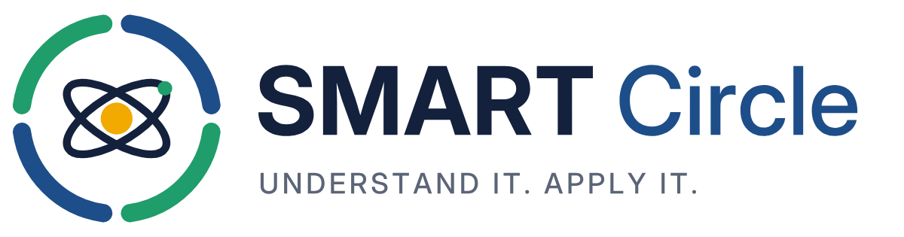

# SMART Circle — Brand Kit

**SMART** = Student Mentorship, Academic Readiness, Technology.
**Tagline:** *Understand it. Apply it.* — every lesson answers "why does this matter?" and "how is it used in real life?"

## The logo

| Part | Meaning |
|---|---|
| **Four ring segments** | Forms 1–4: learners from different schools sitting in one circle, with space between them for everyone |
| **Atom (two orbits)** | Science at the centre of the programme |
| **Amber nucleus** | The "spark" — the moment a topic finally makes sense |
| **Green electron** | A learner moving forward, growing (green also nods to Malawi's flag) |

## Files

| File | Use it for |
|---|---|
| `logo-horizontal.svg` | Site header, letterheads, email headers |
| `logo-horizontal-reversed.svg` | On dark-blue backgrounds |
| `logo-stacked.svg` | Posters, certificates, admission letters |
| `logo-mark.svg` | Symbol alone (profile pictures, stamps, small spaces) |
| `logo-mark-reversed.svg` | Symbol on blue (app icon) |
| `favicon.svg` | Browser tab (simplified: ring + spark, readable at 16 px) |
| `png/icon-192.png`, `png/icon-512.png` | Phone home-screen icon (installable site) |
| `png/apple-touch-icon-180.png` | iPhone/iPad home-screen icon |
| `png/favicon-32.png`, `png/favicon-48.png` | Older browsers |
| `png/logo-horizontal-1200.png` | Documents, WhatsApp, social posts |
| `png/logo-stacked-800.png` | Printed posters and certificates |
| `png/email-signature-400.png` | Email signature |

All text in the SVG files is converted to shapes, so the logo looks identical on every device without installing fonts.

## Colours

| Name | Hex | Use |
|---|---|---|
| **SMART Blue** | `#1D4E89` | Main brand colour: header, buttons, links, headings. White text on it passes (8.4:1). |
| **Growth Green** | `#1F9D6B` | Logo, large headings, progress bars, success states. **Not** for small text (3.5:1). |
| **Green (text)** | `#157A52` | Green buttons and small green text (5.3:1 on white). |
| **Spark Amber** | `#F2A900` | Highlights, "new" badges, the nucleus. **Never** as text on white (2.0:1); fine on Ink or as a fill. |
| **Ink** | `#14213D` | Body text (16:1 on white). |
| **Slate** | `#5B6577` | Secondary text, captions, tagline (5.9:1 on white). |
| **Mist** | `#F4F6FA` | Page background, cards on white. |

Subject accent colours (badges only, always with a text label): Physics `#1D4E89`, Chemistry `#7B3FA0`, Biology `#1F9D6B`, Mathematics `#C2410C`.

## Typography

**Inter** (SIL Open Font License, free for any use) — self-hosted on the site, no outside font service.
- Headings: Inter Display Bold / SemiBold
- Body: Inter Regular, 16 px minimum on phones
- Equations: rendered by the self-hosted maths library in its own maths font

## Rules

- Keep clear space around the logo equal to the height of the nucleus.
- Don't stretch, recolour, rotate, add shadows, or put the full-colour logo on busy photos (use the reversed version on a solid blue panel instead).
- Minimum size: horizontal logo 120 px wide on screen / 30 mm in print; below that use the symbol only.

## Regenerating

The SVGs were generated from code (fonts: Inter, converted to outlines with fontTools). To change wording or colours, edit the generator rather than the SVG by hand.
